<div align="center">

<a href="https://git.io/typing-svg"></a>

# InferServe

### A C++20 inference-serving system for studying dynamic batching, queueing, and tail latency

<p>
  
  
  
  
  
  
</p>

<p><strong>InferServe turns inference serving into a measurable systems problem.</strong><br />It separates admission, queueing, dynamic batching, dispatch, execution, transport, and workload generation so their tradeoffs can be examined directly.</p>

</div>

<p align="center">
  <a href="#project-overview">Overview</a> ·
  <a href="#architecture">Architecture</a> ·
  <a href="#quick-start">Quick start</a> ·
  <a href="#benchmarking-methodology">Methodology</a> ·
  <a href="#experiments-and-results">Results</a> ·
  <a href="#limitations">Limitations</a>
</p>

## Table of contents

- [Project overview](#project-overview)
- [Key capabilities](#key-capabilities)
- [Architecture](#architecture)
- [System requirements and supported behavior](#system-requirements-and-supported-behavior)
- [Quick start](#quick-start)
- [Running InferServe](#running-inferserve)
- [Internal design and implementation](#internal-design-and-implementation)
- [Benchmarking methodology](#benchmarking-methodology)
- [Experiments and results](#experiments-and-results)
- [Reproducing the experiments](#reproducing-the-experiments)
- [Correctness, testing, and validation](#correctness-testing-and-validation)
- [Performance engineering](#performance-engineering)
- [Technology stack](#technology-stack)
- [Design decisions and tradeoffs](#design-decisions-and-tradeoffs)
- [Limitations](#limitations)
- [Roadmap](#roadmap)
- [AI disclosure](#ai-disclosure)

## Project overview

Inference serving is the system around model execution: requests must be
accepted, bounded, queued, grouped, scheduled, executed, and reported while
the service remains responsive under load. A fast model call is not enough if
the admission path overloads, a queue grows without bound, batching increases
tail latency, or the benchmark hides work through its own scheduling behavior.

InferServe is a deliberately small C++20 serving system for making those
interactions visible. It exposes an HTTP API, protects the server with bounded
queues, forms dynamic batches, dispatches them to a worker pool, and supports
both a controlled synthetic backend and ONNX Runtime CPU inference. A separate
load generator produces reproducible open-loop and closed-loop workloads,
records per-request outcomes, and preserves raw CSV, metadata, summary, and
plot artifacts.

The project investigates questions that are easy to blur together in a simple
benchmark: how much waiting helps batch formation, when queueing becomes the
dominant cost, how independent arrivals differ from completion-coupled traffic,
and which conclusions the available measurements can actually support. The
scope is a transparent single-machine research and engineering harness, not a
claim of production capacity.

## Key capabilities

| Capability | What it provides |
| --- | --- |
| Bounded admission | A bounded request queue protects the server and makes overload observable. |
| Backpressure and rejection | Invalid input, queue-full admission, and shutdown are explicit outcomes; dispatch overflow becomes a terminal queue-full failure. |
| Dynamic batching | Requests with compatible input shapes are grouped up to the configured maximum; the delay starts when the first request enters a batch. |
| Batch dispatch | A bounded dispatch queue separates batch formation from execution. |
| Worker pool | A worker pool drains dispatched batches and invokes one shared backend instance. |
| Backend abstraction | The same runtime can use controlled synthetic work or real ONNX Runtime CPU inference. |
| HTTP server | A thin adapter accepts `/infer` requests and exposes completion through `/results/{request_id}`. |
| Independent load generation | Fixed-rate, burst, and Poisson patterns are available; fixed-rate is the Phase 10 open-loop workload. |
| Closed-loop generation | A one-outstanding-request mode waits for completion before scheduling the next request. |
| Benchmark automation | JSON configurations, three repetitions per named configuration, warmup exclusion, summaries, and sidecars are handled by the existing runner. |
| Evidence artifacts | Raw request CSVs, environment metadata, summaries, SVG plots, and experiment reports remain inspectable. |

## Architecture

The server and load generator are separate processes. The generator records
client-observed events; the server owns admission, queues, batching, dispatch,
execution, and completion state.

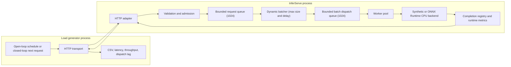

### Request lifecycle

1. The HTTP adapter parses and validates the request. A successful admission
   returns HTTP 202 and a request ID; this is acceptance, not completion.
2. The request enters the bounded admission queue. Invalid input, queue-full
   admission, and shutdown are rejected before execution.
3. The batcher takes the first request, starts the maximum-delay timer, and
   adds compatible requests until the batch is full or the deadline expires.
4. The formed batch enters the bounded dispatch queue. A full dispatch queue
   records a terminal queue-full outcome.
5. The worker pool takes the batch and calls the shared backend. ONNX Runtime
   packs the request inputs into one tensor, executes the actual batch, and
   scatters outputs back to request order.
6. The completion registry stores the terminal result. The load generator
   polls `/results/{request_id}` until completion or failure and records the
   client-observed completion timestamp.

The implementation details and design boundaries are documented in
[`docs/ARCHITECTURE.md`](docs/ARCHITECTURE.md).

### Architecture components

| Component | Responsibility | Important behavior or design choice | Source |
| --- | --- | --- | --- |
| Request types and statuses | Carry request data, timestamps, responses, and terminal status | Statuses distinguish success, invalid input, queue full, shutdown, and internal failure | [`core_types.hpp`](include/inferserve/core_types.hpp) |
| Admission | Validate and accept work | Admission queue capacity is 1024; accepted work is separate from in-flight execution | [`request_admission.hpp`](include/inferserve/request_admission.hpp) |
| Dynamic batcher | Build compatible batches | Delay begins with the first request; zero delay drains immediately | [`batcher.hpp`](include/inferserve/batcher.hpp) |
| Dispatch queue | Buffer formed batches | Bounded handoff between batching and execution | [`batch_dispatch_queue.hpp`](include/inferserve/batch_dispatch_queue.hpp) |
| Worker pool | Execute dispatched batches | Runtime starts one worker and shares one backend instance | [`batch_worker_pool.hpp`](include/inferserve/batch_worker_pool.hpp), [`server_runtime.cpp`](src/server_runtime.cpp) |
| Backend interface | Define inference ownership | Scheduling is outside the backend; `infer()` receives a complete batch | [`backend.hpp`](include/inferserve/backend.hpp) |
| Synthetic backend | Controlled non-model work | Useful for queueing experiments; it must not be presented as model inference | [`synthetic_backend.hpp`](include/inferserve/synthetic_backend.hpp) |
| ONNX Runtime backend | Real CPU model execution | Pinned ONNX Runtime 1.20.1, one shared session, dynamic batch packing/scattering | [`onnx_runtime_backend.hpp`](include/inferserve/onnx_runtime_backend.hpp) |
| HTTP adapter | Translate HTTP to core operations | `/infer` acknowledges admission; `/results/{id}` returns completion state | [`http_server.cpp`](src/http_server.cpp) |
| Load generator | Produce traffic and measurements | Four open-loop HTTP workers; closed-loop mode has one outstanding request | [`open_loop_executor.cpp`](src/load_generator/open_loop_executor.cpp), [`closed_loop_executor.cpp`](src/load_generator/closed_loop_executor.cpp) |

## System requirements and supported behavior

InferServe currently targets Linux x86-64 with a C++20 compiler, CMake 3.25
or newer, Ninja, Python 3.8 or newer, Bash, Git, `wget`, and `sha256sum`.
The normal server build uses the pinned ONNX Runtime CPU 1.20.1 package. The
load generator and its tests can also be built without the server or ONNX
Runtime.

Supported server backends are `synthetic` and `onnx`. The ONNX backend expects
one float32 input and one float32 output; non-batch dimensions must be fixed
and positive, while the leading batch dimension may be fixed or dynamic. The
included dynamic fixture is [`identity_dynamic_batch_2.onnx`](tests/data/identity_dynamic_batch_2.onnx).

The HTTP transport is local, synchronous request/response communication from
the load generator's perspective. It is not a distributed service, GPU
runtime, model repository, autoscaler, or production deployment platform.

## Quick start

### Prerequisites and ONNX Runtime

Install the repository-local ONNX Runtime package from the pinned, checksum-
verified archive:

```sh
./scripts/download_onnxruntime.sh
```

The script requires Bash, `wget`, `sha256sum`, and Python 3.8 or newer. CMake
expects the verified package at
`third_party/onnxruntime-linux-x64-1.20.1/` unless
`INFERSERVE_ONNXRUNTIME_ROOT` is supplied during configuration.

### Configure, build, and test

The supported presets use Ninja and write to `build/<preset>`:

```sh
cmake --preset debug
cmake --build --preset debug
ctest --preset debug --output-on-failure
```

The test-enabled configure downloads the pinned GoogleTest revision through
CMake FetchContent. The repository's equivalent CI workflow is:

```sh
./scripts/ci.sh
```

Other supported sanitizer/release presets are:

```sh
cmake --preset release
cmake --build --preset release
ctest --preset release --output-on-failure

cmake --preset asan
cmake --build --preset asan
ctest --preset asan --output-on-failure

cmake --preset tsan
cmake --build --preset tsan
ctest --preset tsan --output-on-failure
```

ASan and TSan are Linux-only and require GCC or Clang. They are validation
presets, not benchmark configurations.

### ONNX-free load-generator build

When only the standalone load generator and its tests are needed, omit the
server and ONNX-dependent targets:

```sh
cmake -S . -B build/no-onnx -G Ninja -DINFERSERVE_BUILD_SERVER=OFF
cmake --build build/no-onnx
ctest --test-dir build/no-onnx --output-on-failure
```

## Running InferServe

### Server CLI

The server accepts a positional port and these options:

| Option | Default | Meaning |
| --- | --- | --- |
| `[port]` | `8080` | Listen on all interfaces. `0` asks the OS for an ephemeral port. |
| `--backend synthetic\|onnx` | `synthetic` | Select the backend. |
| `--model <path>` | empty | Required for ONNX; invalid with Synthetic. |
| `--max-batch-size <N>` | `32` | Positive maximum batch size, capped by backend/runtime limits. |
| `--max-batch-delay-ms <N>` | `0` | Non-negative wait after the first request enters a batch. |

Use `--help` for the concise built-in syntax. The selected port is printed as
`InferServe listening on port <port>` at startup.

### Synthetic backend

```sh
build/debug/inferserve 18080 \
  --backend synthetic \
  --max-batch-size 8 \
  --max-batch-delay-ms 0
```

### ONNX Runtime CPU backend

The executable links to the repository-local shared library. Set the library
path when the runtime directory is not already visible to the dynamic loader:

```sh
export LD_LIBRARY_PATH="$PWD/third_party/onnxruntime-linux-x64-1.20.1/lib${LD_LIBRARY_PATH:+:$LD_LIBRARY_PATH}"
build/debug/inferserve 18083 \
  --backend onnx \
  --model tests/data/identity_dynamic_batch_2.onnx \
  --max-batch-size 8 \
  --max-batch-delay-ms 0
```

The server must be running before an HTTP load-generator run begins. In a
second terminal, the smallest useful HTTP example is:

```sh
build/debug/inferserve_load_generator fixed-rate 100 50 \
  --warmup-count 10 \
  --http 127.0.0.1 18083 \
  --csv /tmp/inferserve-requests.csv
```

The generator sends `/infer`, receives the request ID, and polls
`/results/{request_id}` until completion. Each HTTP exchange opens and closes a
TCP connection, so the measured completion latency includes connection and
polling overhead.

### Load-generator patterns

```text
inferserve_load_generator fixed-rate <count> <rate-per-second> [options]
inferserve_load_generator burst <count> [options]
inferserve_load_generator poisson <count> <rate-per-second> <seed> [options]
inferserve_load_generator closed-loop <count> [options]

options:
  --warmup-count <N>
  --http <host> <port>
  --csv <file>
```

`--warmup-count` defaults to zero and must be less than the total count.
Without `--http`, requests are simulated locally. Closed-loop mode sends one
request, waits for its completion, and then schedules the next request; it has
no fixed offered-rate argument.

## Internal design and implementation

The server runtime constructs the backend, starts the batcher and one-worker
pool, runs the HTTP adapter, then stops admission and drains processing during
shutdown. The key modules are:

| Area | Implementation | Notes |
| --- | --- | --- |
| Lifecycle and completion | [`core_types.hpp`](include/inferserve/core_types.hpp), [`completion_registry.hpp`](include/inferserve/completion_registry.hpp) | Carries request state and terminal results to polling clients. |
| Admission and queueing | [`request_admission.hpp`](include/inferserve/request_admission.hpp), [`bounded_queue.hpp`](include/inferserve/bounded_queue.hpp) | Bounded waiting capacity and explicit rejection. |
| Batching | [`batcher.hpp`](include/inferserve/batcher.hpp) | Compatible requests are grouped up to the configured size/deadline. |
| Dispatch and execution | [`batch_dispatch_queue.hpp`](include/inferserve/batch_dispatch_queue.hpp), [`batch_worker_pool.hpp`](include/inferserve/batch_worker_pool.hpp) | Separates forming a batch from running it. |
| Backend boundary | [`backend.hpp`](include/inferserve/backend.hpp), [`synthetic_backend.hpp`](include/inferserve/synthetic_backend.hpp), [`onnx_runtime_backend.hpp`](include/inferserve/onnx_runtime_backend.hpp) | One shared backend is borrowed by the worker pool. |
| HTTP | [`http_server.cpp`](src/http_server.cpp) | Four client worker threads, `/infer`, and `/results/{id}` routes. |
| Load generation | [`traffic_pattern.cpp`](src/load_generator/traffic_pattern.cpp), [`open_loop_executor.cpp`](src/load_generator/open_loop_executor.cpp), [`closed_loop_executor.cpp`](src/load_generator/closed_loop_executor.cpp) | Scheduling is outside server state. |
| Transport and statistics | [`http_transport.cpp`](src/load_generator/http_transport.cpp), [`performance_stats.cpp`](src/load_generator/performance_stats.cpp), [`dispatch_lag.cpp`](src/load_generator/dispatch_lag.cpp) | Completion polling, latency, throughput, failures, and send lag. |

## Benchmarking methodology

The benchmark methodology is designed to expose serving behavior without
confusing admission with completed inference.

### Workload modes

- **Open-loop:** fixed-rate arrivals are scheduled independently of earlier
  completions. Four load-generator workers send requests; when the pending
  client queue is busy, actual send time can lag the schedule.
- **Closed-loop:** one request is outstanding at a time. The next request is
  scheduled only after the previous request's completion result is observed.
  Its effective offered rate therefore falls when latency rises.
- **Warmup:** leading requests execute in the same invocation but are excluded
  from latency, throughput, dispatch-lag, and failure summaries. They remain in
  the raw CSV.
- **Repetitions:** the JSON runner executes each named configuration three
  times. Summaries report the median, minimum, and maximum of the per-run
  percentiles and throughput.

### Measurements

| Metric | Definition and interpretation |
| --- | --- |
| Completion latency | `completion_ms - scheduled_arrival_ms` for successful dispatched measured requests. This is client-observed end-to-end latency, including client scheduling, TCP setup/teardown, admission, polling, and detection delay. |
| Backend time | Not exported in Phase 10 CSVs. Completion latency must not be described as pure model execution time. |
| Throughput | Successful dispatched measured requests divided by the generator's measured completion window; it is not a server-side counter. |
| Dispatch lag | `actual_send_ms - scheduled_arrival_ms` at the load generator. It includes client scheduling/transport effects and is not a direct server queue-time measurement. |
| Success | A request whose completion result reports successful inference. HTTP 202 alone means admission. |
| Rejection/failure | HTTP rejection, terminal failure, or other unsuccessful result recorded separately from successful throughput. |
| Undispatched | A request never sent by the load generator, for example because its pending client queue was full. |

The plots and CSV semantics are documented in
[`docs/BENCHMARK_PLOTS.md`](docs/BENCHMARK_PLOTS.md). The benchmark artifacts do
not export a per-request batch identifier or batch-size distribution, so actual
batch aggregation cannot be verified from Phase 10 results.

### Coordinated omission

Completion-coupled closed-loop traffic stops presenting independent arrivals
during a slow response. It can therefore under-sample queueing and tail
latency compared with an independently scheduled open-loop workload. Phase
10.4 demonstrates this scheduling mechanism, especially in the revised 1 ms
delay comparison, but it is not a rate-matched causal estimate: the modes have
different effective offered loads and concurrency.

## Experiments and results

All Phase 10 experiments use HTTP transport, completion polling, 1,100 total
requests, 100 warmup requests, 1,000 measured requests, and three repetitions
unless stated otherwise. Values below are medians across per-run metrics; ranges
are the minimum and maximum repetition values.

### Phase 10.1 — batching off versus batching on

**Question.** Does enabling the dynamic batching path change latency or
throughput under a fixed 500 RPS workload?

**Setup.** Synthetic and ONNX Runtime CPU backends were each compared with
batching off and on. The ONNX runs used the dynamic identity fixture. All runs
were fixed-rate open-loop.

| Configuration | p50 ms | p95 ms | p99 ms | Throughput req/s |
| --- | ---: | ---: | ---: | ---: |
| Synthetic off | 535.617 (456.915–552.631) | 942.180 (847.081–975.322) | 977.601 (882.080–1008.575) | 335.169 (332.068–346.382) |
| Synthetic on | 529.725 (520.266–557.214) | 967.007 (921.722–982.708) | 1002.369 (954.846–1022.638) | 332.983 (329.523–337.440) |
| ONNX off | 1.048 (0.879–1.133) | 14.159 (13.950–17.140) | 21.601 (21.210–29.655) | 500.244 (497.642–500.246) |
| ONNX on | 1.084 (0.905–1.191) | 12.293 (11.951–13.038) | 17.056 (15.444–17.783) | 500.220 (500.177–500.282) |

The ONNX workload sustained approximately the offered rate. Synthetic runs
were unstable below 500 RPS, and batching-on versus batching-off overlapped.
The ONNX tail medians were slightly lower with batching enabled, but the
artifacts do not prove a large batching effect because formed batch sizes were
not exported.

Details and raw artifacts: [`phase-10-1/RESULTS.md`](experiment-results/phase-10-1/RESULTS.md), [`phase-10-1/`](experiment-results/phase-10-1/).

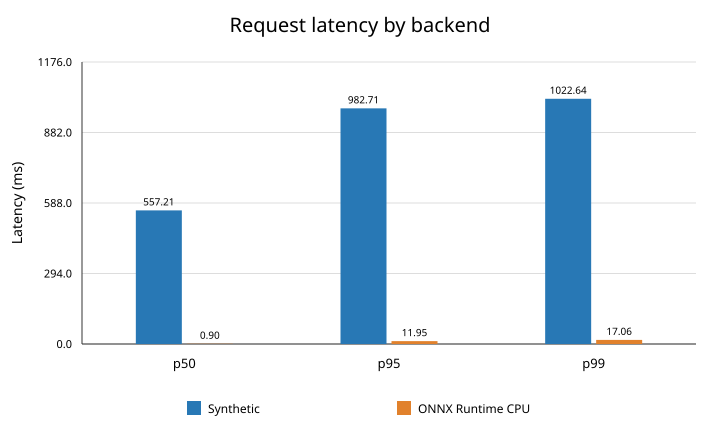

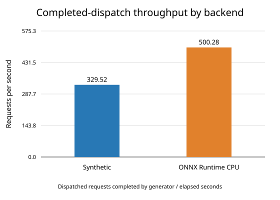

### Phase 10.2 — maximum batching delay

**Question.** What is the latency/throughput tradeoff when the maximum batch
formation delay is 0, 1, or 5 ms?

**Setup.** ONNX Runtime CPU, `identity_dynamic_batch_2.onnx`, maximum batch size
8, fixed 500 RPS open-loop traffic, and only the delay changed.

| Maximum delay | p50 ms | p95 ms | p99 ms | Throughput req/s |
| ---: | ---: | ---: | ---: | ---: |
| 0 ms | 0.941 (0.835–2.251) | 12.664 (12.371–34.038) | 22.428 (16.249–40.691) | 498.630 (498.197–499.835) |
| 1 ms | 477.096 (438.689–491.080) | 889.684 (765.010–950.366) | 926.394 (801.031–992.848) | 341.300 (332.710–356.341) |
| 5 ms | 528.427 (520.083–599.074) | 974.941 (959.598–1060.639) | 1016.865 (987.510–1102.065) | 330.319 (322.160–333.854) |

Under this workload, waiting to form batches coincided with much higher
completion latency and lower completed-request throughput. The experiment does
not establish a generally optimal delay or prove that formed batches changed,
because batch composition was not exported and only three repetitions were
used.

Details: [`phase-10-2/RESULTS.md`](experiment-results/phase-10-2/RESULTS.md).

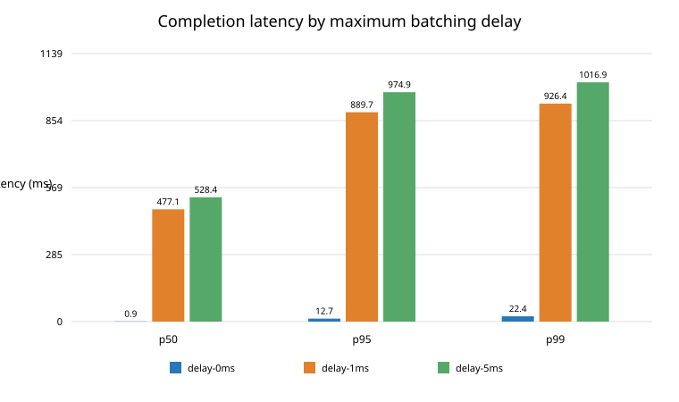

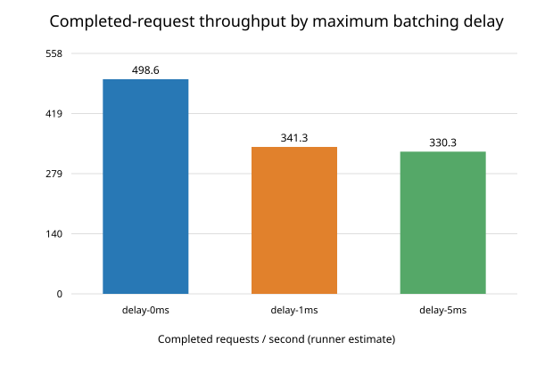

### Phase 10.3 — increasing offered load

**Question.** At what offered rate does achieved throughput stop scaling and
latency begin to rise substantially?

**Setup.** ONNX Runtime CPU, dynamic identity model, batch size 8, delay 0 ms,
fixed-rate open-loop HTTP traffic, and rates from 100 through 3,000 RPS. The
final matrix contains 8 rates × 3 repetitions = 24 successful runs.

| Offered RPS | p50 ms | p95 ms | p99 ms | Achieved req/s | Median dispatch lag ms |
| ---: | ---: | ---: | ---: | ---: | ---: |
| 100 | 1.630 | 11.387 | 11.958 | 100.082 | 0.29 |
| 250 | 1.512 | 11.957 | 12.320 | 249.531 | 0.20 |
| 500 | 1.381 | 24.619 | 33.987 | 495.855 | 0.22 |
| 750 | 1.001 | 40.112 | 49.125 | 748.921 | 0.16 |
| 1,000 | 0.860 | 36.341 | 43.445 | 994.485 | 0.15 |
| 1,500 | 0.536 | 14.585 | 23.122 | 1,500.150 | 0.09 |
| 2,000 | 3.481 | 78.695 | 83.698 | 1,969.904 | 0.17 |
| 3,000 | 1.700 | 67.951 | 73.551 | 2,934.565 | 0.70 |

Latency tails and dispatch-lag variability increased at higher rates, but
throughput continued to track offered load through 3,000 RPS. This is evidence
of increased variability, not a demonstrated throughput plateau or definitive
saturation point. The p50 values are non-monotonic and should not be treated as
a capacity curve.

Details and plots: [`phase-10-3/RESULTS.md`](experiment-results/phase-10-3/RESULTS.md), [`phase-10-3/`](experiment-results/phase-10-3/).

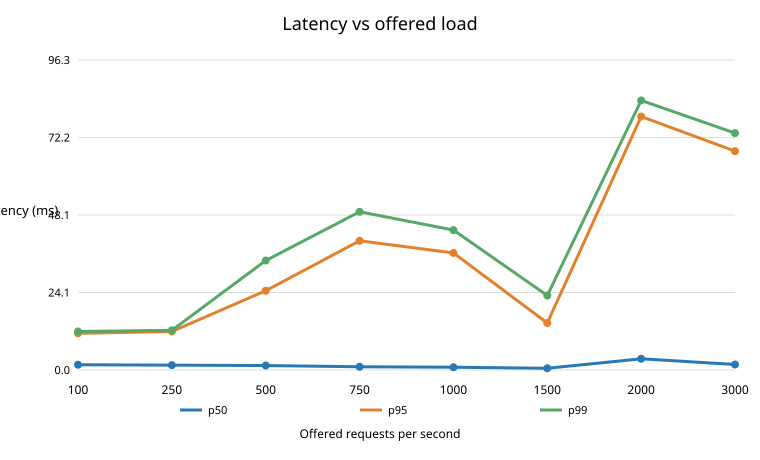

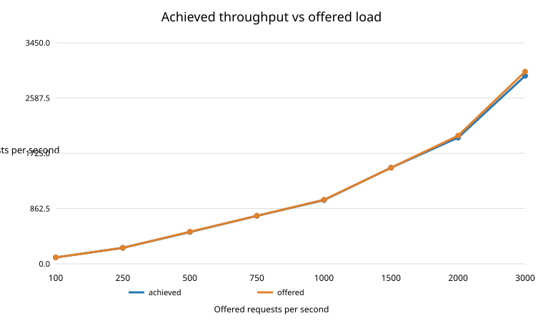

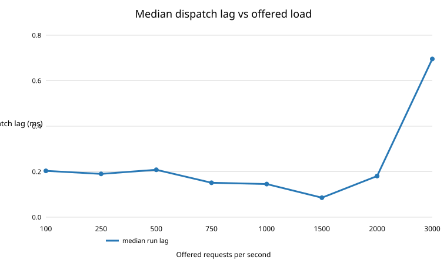

### Phase 10.4 — open-loop versus closed-loop

**Question.** Does completion-coupled generation change offered load and the
latency observed under independently scheduled traffic?

#### Original zero-delay baseline

Both modes used ONNX Runtime CPU, batch size 8, delay 0 ms, and 500 RPS as the
open-loop target. Closed-loop had one outstanding request and no fixed rate.

| Mode | p50 ms | p95 ms | p99 ms | Throughput req/s | Effective scheduled req/s |
| --- | ---: | ---: | ---: | ---: | ---: |
| Open-loop, 500 RPS | 1.074 (0.874–1.186) | 11.660 (11.542–12.107) | 14.312 (14.261–15.032) | 500.219 (499.945–500.285) | 500 |
| Closed-loop | 0.240 (0.147–0.511) | 10.565 (1.543–11.429) | 11.707 (11.461–11.924) | 1,007.118 (505.966–1,381.828) | 1,001 (518–1,419) |

The baseline confirms the scheduling difference but did not create a controlled
sustained slowdown or a rate-matched comparison. It supports a mechanism-level
interpretation only. See [`phase-10-4/RESULTS.md`](experiment-results/phase-10-4/RESULTS.md).

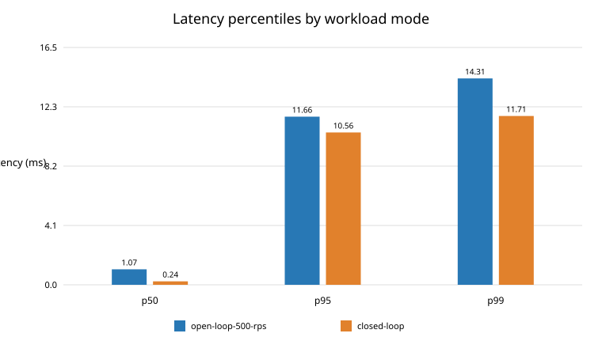

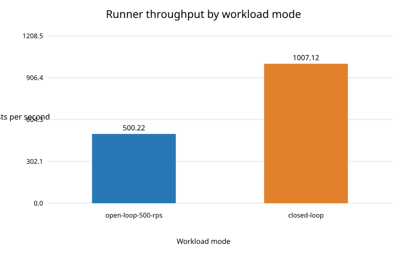

#### Revised 1 ms delay comparison

The revised run kept the workload identical between modes and used the
CLI-supported 1 ms maximum batch delay to create a measurable slowdown.

| Mode | p50 ms | p95 ms | p99 ms | Throughput req/s | Effective scheduled req/s |
| --- | ---: | ---: | ---: | ---: | ---: |
| Open-loop, 500 RPS, 1 ms | 480.147 (448.502–502.515) | 882.519 (823.443–914.653) | 916.211 (850.216–953.215) | 342.564 (337.563–350.759) | 500 |
| Closed-loop, 1 ms | 11.932 (11.913–12.087) | 12.534 (12.442–12.676) | 12.778 (12.651–12.871) | 83.752 (82.755–83.891) | 84 |

Open-loop traffic continued to schedule 500 RPS while dispatch lag and
completion latency grew. Closed-loop traffic reduced its effective generation
rate to approximately 83–84 RPS and consequently observed much lower latency.
This demonstrates the measurement mechanism and its consequence under this
condition; it is not a rate-matched comparison or a general capacity law.

Details and revised artifacts: [`phase-10-4/revised-delay-1ms/RESULTS.md`](experiment-results/phase-10-4/revised-delay-1ms/RESULTS.md), [`phase-10-4/revised-delay-1ms/`](experiment-results/phase-10-4/revised-delay-1ms/).

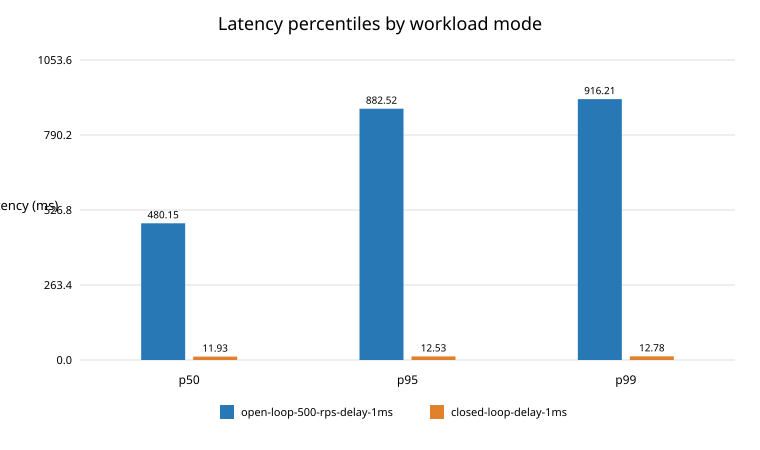

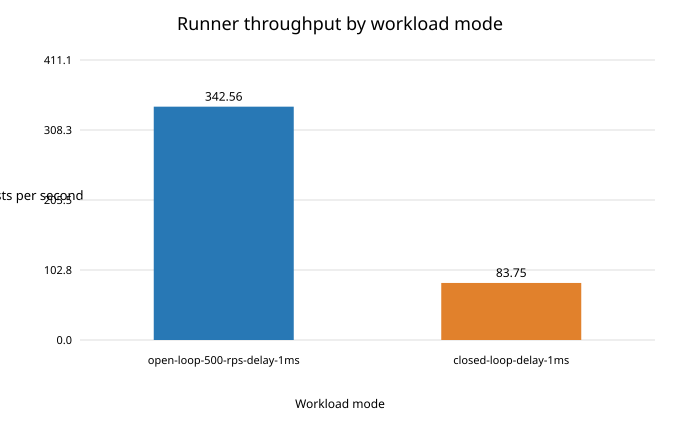

### Consolidated interpretation

InferServe's experiments show that queueing and batching policy can dominate
client-observed completion latency even when the backend model itself is
small. They also show why workload generation is part of measurement design:
open-loop traffic preserves an independent arrival schedule, while closed-loop
traffic reduces offered load as responses slow. The evidence is strongest as a
comparison of mechanisms and observed behavior under fixed local conditions;
it does not establish a universal batching policy, production capacity, or
general saturation threshold.

## Reproducing the experiments

### 1. Build the benchmark executable

From a clean checkout:

```sh
./scripts/download_onnxruntime.sh
cmake --preset debug
cmake --build --preset debug
ctest --preset debug --output-on-failure
```

Set the ONNX Runtime library path before launching an ONNX server:

```sh
export LD_LIBRARY_PATH="$PWD/third_party/onnxruntime-linux-x64-1.20.1/lib${LD_LIBRARY_PATH:+:$LD_LIBRARY_PATH}"
```

### 2. Start the server separately

The JSON runner launches the load generator and does not start or configure an
InferServe server. Start the server with the command recorded in the relevant
experiment artifact, then ensure its port matches the configuration.

For example, Phase 10.1 ONNX uses:

```sh
build/debug/inferserve 18083 \
  --backend onnx \
  --model tests/data/identity_dynamic_batch_2.onnx \
  --max-batch-size 8 \
  --max-batch-delay-ms 0
```

### 3. Run a checked-in configuration

The runner resolves each configuration's relative `load_generator` and
`output_dir` from the configuration file's directory:

```sh
python3 scripts/run_experiment.py experiments/phase-10-1-onnx-on.json
```

The runner executes each named configuration three times and writes:

- one `requests.csv` per repetition;
- one `requests.csv.metadata.json` sidecar per CSV;
- `experiment-summary.json` with run status and aggregates.

Checked-in configurations are available for:

- [`phase-10-1-onnx-on.json`](experiments/phase-10-1-onnx-on.json)
- [`phase-10-1-synthetic-on.json`](experiments/phase-10-1-synthetic-on.json)
- [`phase-10-2-onnx-delay.json`](experiments/phase-10-2-onnx-delay.json)
- [`phase-10-3-onnx-load.json`](experiments/phase-10-3-onnx-load.json)
- [`phase-10-4-open-vs-closed.json`](experiments/phase-10-4-open-vs-closed.json)
- [`phase-10-4-revised-delay-1ms.json`](experiments/phase-10-4-revised-delay-1ms.json)

The runner supports `--load-generator` and `--output-dir` overrides. Newly
generated summaries contain absolute `csv` and `metadata` path strings because
the runner resolves them; the checked-in summaries have been normalized to
relative paths for portability.

### 4. Generate plots and inspect artifacts

The general plotting script compares one Synthetic CSV and one ONNX CSV:

```sh
python3 scripts/plot_benchmark_results.py \
  --synthetic synthetic.csv \
  --onnx onnx.csv \
  --output-dir plots
```

It produces `latency_percentiles.svg` and `throughput.svg`. The Phase 10.2,
10.3, and 10.4 directories also contain experiment-specific `plot_results.py`
scripts and pre-generated plots for their multi-configuration comparisons.
Those scripts consume the existing summaries/CSVs and should be treated as
experiment-specific reporting tools, not replacements for the general parser.

## Correctness, testing, and validation

The C++ test targets cover request lifecycle, HTTP behavior, runtime metrics,
server option parsing, completion handling, batching/worker interactions, and
the load-generator executors, transport, CSV export, dispatch lag, traffic
patterns, and performance statistics. CTest also registers the Python parser
and experiment-runner tests.

Latest local verification (2026-11-28): the Debug build was cleaned and rebuilt
from scratch, then all 119 discovered CTest tests passed. The standalone ONNX
Runtime batch benchmark also completed for batch sizes 1 and 3 with output
checksum `3850.000000`; its one-run latency sample is recorded in
[`benchmarks/README.md`](benchmarks/README.md). That microbenchmark is a smoke
measurement and should not be treated as a portable performance baseline.

Run the full configured test suite with:

```sh
ctest --preset debug --output-on-failure
```

Focused Python plot tests can be run directly:

```sh
python3 -m unittest tests/test_plot_benchmark_results.py
```

ASan and TSan presets provide additional memory and concurrency validation on
Linux with GCC or Clang. These tests establish implementation behavior for the
covered cases; they do not prove production capacity, backend performance on
other models, or a universal saturation threshold.

## Performance engineering

InferServe treats performance as a systems interaction rather than a single
model timing. The relevant variables are:

- **Scheduling:** independent arrivals versus completion-coupled generation.
- **Queueing:** bounded admission and dispatch queues make pressure visible.
- **Batching:** waiting can increase batch opportunity while adding completion
  latency.
- **Concurrency:** the server uses a worker pool over one shared backend; the
  current runtime starts one worker.
- **Throughput:** the reported value is successful completed work per measured
  client completion window.
- **Tail latency:** p95 and p99 expose queueing and scheduling variability that
  p50 can hide.
- **Measurement:** dispatch lag and completion polling show client-visible
  behavior, not isolated backend execution.

The Phase 10 results show meaningful latency tradeoffs and variability under
the selected local workload. They intentionally stop short of unsupported
claims about production performance or superiority over other serving systems.

## Technology stack

| Technology | Role | Why it matters here |
| --- | --- | --- |
| C++20 | Server, runtime, backend, and load generator | Precise ownership, concurrency, and low-level timing control. |
| CMake + Ninja | Configure and build | Reproducible Debug, Release, ASan, and TSan workflows. |
| ONNX Runtime 1.20.1 | CPU inference backend | Real model execution behind the backend boundary. |
| GoogleTest | C++ tests | Exercises lifecycle, queues, runtime, HTTP, and load-generator behavior. |
| Python 3 | Runner, plotting, and dependency validation | Small standard-library tools preserve experiment artifacts. |
| Linux tools | Bash, `wget`, `sha256sum`, CTest | Supports dependency setup and native validation. |

## Design decisions and tradeoffs

| Decision | Benefit | Tradeoff |
| --- | --- | --- |
| Bounded queues | Backpressure is explicit and memory growth is bounded. | Requests can be rejected or become terminal queue-full failures under pressure. |
| Dynamic batching | Compatible requests can share one backend call. | Waiting for a batch can increase completion latency; batch composition is not exported in current artifacts. |
| Separate dispatch queue | Decouples batch formation from worker execution. | Adds another bounded queue and another overload boundary. |
| Worker pool with one shared backend | Avoids duplicate model/session ownership and keeps scheduling separate from inference. | Backend concurrency must be safe, and the current runtime uses one worker. |
| Backend abstraction | Synthetic and ONNX behavior can use the same serving path. | Synthetic work is not evidence of model performance. |
| Separate open-loop generator | Preserves independently scheduled arrivals for overload and tail-latency studies. | Client scheduling and transport still contribute to observed measurements. |
| Closed-loop mode | Makes completion-coupled behavior explicit for coordinated-omission study. | Its effective offered rate changes with latency and cannot be rate-matched by the existing mode. |
| Completion polling | Makes asynchronous server completion observable through a small HTTP API. | Polling and connection setup/teardown add overhead and detection delay. |
| Single-machine scope | Keeps experiments reproducible and inspectable. | Results do not model distributed networking, orchestration, or multi-node capacity. |

## Limitations

- The project targets CPU inference on one machine; there is no GPU backend,
  distributed serving, model repository, autoscaling, or production
  orchestration.
- Phase 10 CSV and metadata artifacts do not export batch-size distributions or
  per-request batch membership, so configured batch limits are not proof that
  larger batches formed.
- Backend execution time and server-only queue intervals are not directly
  available in the benchmark artifacts. Completion latency is client-observed.
- HTTP connection setup/teardown and completion polling contribute to latency.
- Dispatch lag is measured at the load generator's send boundary and includes
  client scheduling/transport effects.
- Phase 10.3 observed higher latency/dispatch-lag variability at high rates but
  did not establish a clear throughput plateau or definitive saturation point.
- Phase 10.4 is a mechanism-level coordinated-omission comparison, not a
  rate-matched causal quantification.
- The optional profiling phase was skipped because the environment's
  `perf_event_paranoid=4` restriction prevented perf-based hotspot profiling;
  lightweight process monitoring did not establish CPU hotspots.
- Results are short local experiments with three repetitions and are sensitive
  to machine load, scheduler timing, model choice, and runtime configuration.

## Roadmap

| Status | Scope |
| --- | --- |
| Completed | Phases 0–9: foundation, request lifecycle, bounded queues, backend boundary, batching, dispatch, ONNX Runtime CPU, HTTP, load generation, and metrics hardening. |
| Completed | Phase 10: batching comparison, batching-delay experiment, offered-load sweep, and open-loop/closed-loop mechanism comparison. |
| Optional / skipped | Phase 11 profiling: skipped because the environment did not permit perf hardware-counter or sampling profiling. |
| Completed | Phase 12 documentation and reproducibility work, including setup guidance, portability corrections, architecture/methodology documentation, and this final README. |
| Future work | Export batch-size distributions and server-side timing, add broader models and backends, study longer and controlled saturation workloads, and evaluate distributed deployment. |

## AI disclosure

AI assistance was used extensively throughout InferServe to accelerate implementation, debugging, documentation, and development workflows. AI was used to assist with planning and breaking down development phases, exploring architectural approaches and design decisions, identifying test cases and edge cases, and accelerating implementation and troubleshooting. However, project direction, development decisions, reviewing generated changes, validating implementation behavior, evaluating test results, verifying benchmark artifacts, and assessing conclusions were handled by me. AI served as a productivity tool to accelerate the development process, not as a substitute for my own review, judgment, or understanding of the system.

<div align="center">

<br />

**InferServe** · systems engineering for measurable inference serving

</div>
