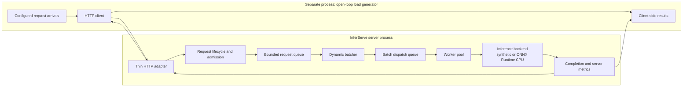
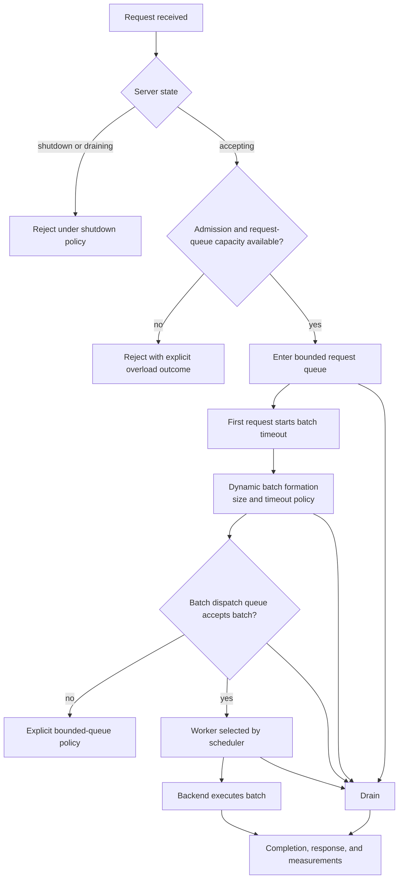

# InferServe v1 architecture

InferServe is a planned C++20 CPU inference server for measuring how dynamic
batching policy affects throughput and tail latency. This document describes
the **intended v1 architecture**. Except for the Phase 0 foundation and
development infrastructure, the runtime components below are not implemented
yet.

## Design boundaries

The server core owns request admission, bounded queues, batching, dispatch,
execution coordination, and server-side measurements. HTTP is an adapter at
the edge, not part of core inference logic. The load generator is a separate,
open-loop component/process, so it measures the server without client-side
closed-loop feedback masking overload or tail latency.

The inference backend is also behind a boundary. A synthetic backend provides
controlled, explicitly non-model work for experiments; it must never be
presented as real model inference. A later ONNX Runtime CPU backend performs
real model inference. Scheduling decides *when and where* work runs; a backend
only executes an already dispatched batch.

The diagram’s load-generator boundary is intentional: it is not an internal
server module and does not share the server’s scheduling or metrics state.

## Intended request lifecycle

Admission is the decision to accept or reject a received request. Execution
begins only after acceptance and later scheduling. Queue capacity counts
waiting requests, not requests already in flight. Both queues are bounded and
their overload behavior must be explicit when their phases are implemented.

The exact rejection status, dispatch-full behavior, and shutdown policy details
remain implementation decisions. The intended guarantee is that shutdown can
drain outstanding accepted work rather than discarding it implicitly.

## Components and responsibilities

| Component | Primary responsibility | What it must not own | Relevant future phase |
| --- | --- | --- | --- |
| Foundation | Build, test, dependency, and documentation infrastructure | Request processing or inference behavior | 0 — Foundation |
| Request lifecycle and admission | Request state, validation, acceptance/rejection boundaries | Batching policy, worker ownership, transport implementation | 1 — Core types and request lifecycle |
| Bounded request queue | Hold accepted waiting requests and enforce waiting-capacity policy | In-flight accounting, batch execution, HTTP semantics | 2 — Bounded queue and concurrency |
| Backend interface and synthetic backend | Define the backend boundary and controlled synthetic execution for experiments | Claims of real model inference or scheduling | 3 — Backend interface and synthetic backend |
| Dynamic batcher | Form batches from queued requests; start timeout at the first request in a batch | Worker selection, HTTP handling, backend internals | 4 — Dynamic batcher |
| Batch dispatch queue | Buffer ready batches between batching and execution | Request admission or backend execution | 5 — Worker pool and dispatch queue |
| Worker pool and scheduler | Select workers and run dispatched batches | Batch-formation policy or transport concerns | 5 — Worker pool and dispatch queue |
| ONNX Runtime CPU backend | Execute real CPU model inference for a supplied batch | Admission, queue ownership, scheduling decisions | 6 — ONNX Runtime CPU backend |
| Thin HTTP adapter | Translate HTTP requests/responses to and from core lifecycle operations | Core queue, batching, scheduling, or inference policies | 7 — HTTP adapter |
| Open-loop load generator | Generate independently scheduled arrivals and client-observed measurements | Server queues, server scheduling, or server metric ownership | 8 — Open-loop load generator |
| Metrics and reporting | Record and report measurement definitions and benchmark conditions | Altering workload or scheduling behavior | 9 — Metrics, reporting and methodology hardening |
| Experiments | Run documented comparisons of policies and conditions | Quietly changing architecture or methodology | 10 — Experiments |
| Profiling and one real optimization | Profile and improve one demonstrated bottleneck with before/after evidence | Broad speculative rewrites | 11 — Profiling and one real optimization |
| Documentation and validation | Consolidate evidence, documentation, and project validation | Adding unmeasured functionality | 12 — Documentation and validation |

## Measurement model

Server-side measurement is intended to distinguish end-to-end latency from
queueing, batching, dispatch, and backend latency. These intervals must have
documented boundaries when instrumentation is introduced; this document does
not prescribe timestamp implementation details.

Load-generator measurements are distinct: they observe arrivals and outcomes
from outside the server. Its open-loop schedule avoids coordinated omission,
where a closed-loop client slows submission after slow responses and therefore
under-samples overload. Server and client results should be reported together,
not silently substituted for one another.

Benchmark conditions must be reproducible and documented, including workload
shape, arrival process, batching policy, queue capacities, worker settings,
backend choice, model details when applicable, hardware/software environment,
and measurement definitions.

## Architectural decisions

1. The batch timeout starts when the first request enters a batch.
2. Queue capacity excludes requests already in flight.
3. Shutdown supports draining outstanding accepted work.
4. Measurements distinguish end-to-end, queueing, batching, dispatch, and backend latency.
5. Synthetic inference is explicitly synthetic, never real model inference.
6. The load generator is separate and open-loop to avoid coordinated omission.
7. Benchmark conditions are reproducible and documented.
8. Scheduling is separate from backend execution.
9. HTTP transport is separate from the core inference system.
10. Queues are bounded and overload behavior is explicit.

These are v1 design commitments. They do not assert that the corresponding
components or measurements already exist in the current repository.
