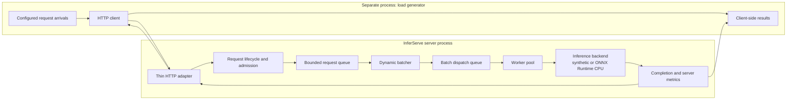
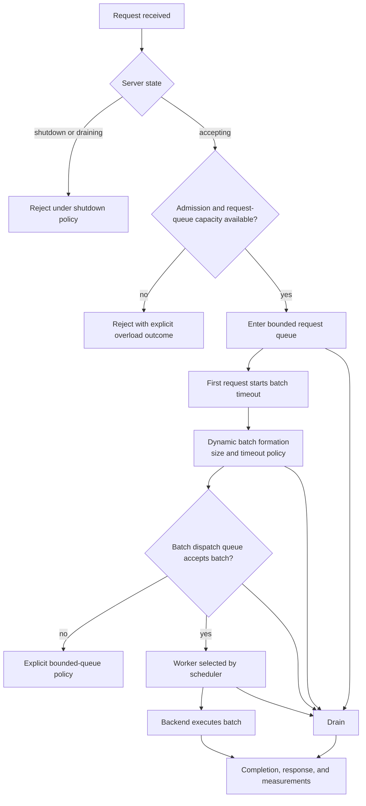

# InferServe v1 architecture

InferServe is a C++20 CPU inference server for measuring how dynamic batching
policy affects throughput and tail latency. This document describes the
**intended v1 architecture** and records implemented backend behavior below.

## Design boundaries

The server core owns request admission, bounded queues, batching, dispatch,
execution coordination, and server-side measurements. HTTP is an adapter at
the edge, not part of core inference logic. The load generator is a separate
process. Phase 10 uses its fixed-rate open-loop mode for independently
scheduled arrivals; a completion-coupled closed-loop mode is also available
for the mechanism-level comparison described below.

The inference backend is also behind a boundary. A synthetic backend provides
controlled, explicitly non-model work for experiments; it must never be
presented as real model inference. A later ONNX Runtime CPU backend performs
real model inference. Scheduling decides *when and where* work runs; a backend
only executes an already dispatched batch.

The diagram’s load-generator boundary is intentional: it is not an internal
server module and does not share the server’s scheduling or metrics state.

## Intended request lifecycle

Admission is the decision to accept or reject a received request. The HTTP
adapter validates the request and returns an admission response; HTTP 202
means that the request was accepted, not that inference has completed.
Execution begins only after acceptance and later scheduling. The admission
queue and batch-dispatch queue each have capacity 1024, and queue capacity
counts waiting work rather than work already executing. Invalid input,
queue-full admission, and shutdown are rejected explicitly. A dispatch-queue
overflow becomes a terminal completion failure. Accepted work is then
completed by the backend and exposed through the completion registry for
`/results/{request_id}` polling.

The runtime stops admission, drains the batcher, then drains and joins the
worker pool so accepted work is not silently discarded. The HTTP status and
JSON response details are implementation-level protocol behavior; benchmark
results should use the recorded success, failure, rejection, and undispatched
fields rather than infer completion from admission alone.

## Components and responsibilities

| Component | Primary responsibility | What it must not own | Relevant future phase |
| --- | --- | --- | --- |
| Foundation | Build, test, dependency, and documentation infrastructure | Request processing or inference behavior | 0 — Foundation |
| Request lifecycle and admission | Request state, validation, acceptance/rejection boundaries | Batching policy, worker ownership, transport implementation | 1 — Core types and request lifecycle |
| Bounded request queue | Hold accepted waiting requests and enforce waiting-capacity policy | In-flight accounting, batch execution, HTTP semantics | 2 — Bounded queue and concurrency |
| Backend interface and synthetic backend | Define the backend boundary and controlled synthetic execution for experiments | Claims of real model inference or scheduling | 3 — Backend interface and synthetic backend |
| Dynamic batcher | Form batches from queued requests; start timeout at the first request in a batch | Worker selection, HTTP handling, backend internals | 4 — Dynamic batcher |
| Batch dispatch queue | Buffer ready batches between batching and execution | Request admission or backend execution | 5 — Worker pool and dispatch queue |
| Worker pool and scheduler | Select workers and run dispatched batches | Batch-formation policy or transport concerns | 5 — Worker pool and dispatch queue |
| ONNX Runtime CPU backend | Execute real CPU model inference for a supplied batch | Admission, queue ownership, scheduling decisions | 6 — ONNX Runtime CPU backend |
| Thin HTTP adapter | Translate HTTP requests/responses to and from core lifecycle operations | Core queue, batching, scheduling, or inference policies | 7 — HTTP adapter |
| Load generator | Generate open-loop or completion-coupled closed-loop arrivals and client-observed measurements | Server queues, server scheduling, or server metric ownership | 8 — Open-loop load generator |
| Metrics and reporting | Record and report measurement definitions and benchmark conditions | Altering workload or scheduling behavior | 9 — Metrics, reporting and methodology hardening |
| Experiments | Run documented comparisons of policies and conditions | Quietly changing architecture or methodology | 10 — Experiments |
| Profiling and one real optimization | Profile and improve one demonstrated bottleneck with before/after evidence | Broad speculative rewrites | 11 — Profiling and one real optimization |
| Documentation and validation | Consolidate evidence, documentation, and project validation | Adding unmeasured functionality | 12 — Documentation and validation |

## Measurement model

The load generator's completion latency is measured from the scheduled arrival
to the completion observed by the client. It includes client scheduling delay,
HTTP connection setup/teardown, the admission request, completion polling, and
polling detection delay. It is therefore a client-observed end-to-end measure,
not backend execution time. Backend execution and internal queue intervals are
not exported in the Phase 10 CSV format.

In open-loop mode, arrivals are scheduled independently of earlier
completions. The four HTTP workers may send late when their pending work is
busy; `dispatch_lag_ms` records actual send time minus scheduled arrival and
therefore includes client scheduling and transport effects as well as pressure
visible at the client. In closed-loop mode, one request is sent and completed
before the next is scheduled, so its effective offered rate falls as
completion latency rises. The two modes are not rate-matched workloads.

This difference is the coordinated-omission mechanism: a completion-coupled
client does not issue arrivals during a slow interval and can under-sample the
queueing and tail latency that an independently scheduled client observes.
Phase 10.4 supports that mechanism-level interpretation only. Its runs did not
provide a controlled sustained slowdown or a rate-matched causal estimate of
the bias.

For the benchmark reports, throughput is the generator-side estimate of
successful dispatched measured requests divided by the measured completion
window. Warmup rows remain in the CSV but are excluded from latency,
throughput, and failure summaries. `success` describes a completed inference;
HTTP rejection and terminal failure are separate outcomes, while
`undispatched` identifies requests never sent by the generator. These fields
must be reported explicitly rather than treating an HTTP 202 admission as a
successful completion.

Benchmark conditions must be reproducible and documented, including workload
shape, arrival process, batching policy, queue capacities, worker settings,
backend choice, model details when applicable, hardware/software environment,
and measurement definitions.

The Phase 10 CSV and sidecars do not export a batch-size distribution or a
per-request batch identifier, so batch aggregation cannot be verified from
those artifacts. Phase 10.3 showed increased latency and dispatch-lag
variability at higher offered rates, but achieved throughput continued to track
offered load through 3,000 RPS; it therefore does not establish a clear
throughput plateau or definitive saturation point.

The experiment runner resolves output directories and writes absolute `csv`
and `metadata` path strings into newly generated summary JSON. This is current
runner behavior and makes those fields checkout-specific; checked-in summaries
may normalize them to relative paths for portability without changing results.

## Backend ownership and concurrency

The worker pool uses one shared backend instance. `BatchWorkerPool` borrows a
`Backend&`; the owner constructs and loads the backend before starting the pool,
keeps it alive until the pool has shut down and joined, and destroys it
afterward. The pool does not own, clone, or initialize separate backend
instances. Since workers call `infer()` concurrently on that shared instance,
every implementation must either support concurrent inference or synchronize
inside `infer()`. `load()` is completed before workers start.

Phase 6.3 retains one shared `Ort::Session` for the worker pool. The project
pins ONNX Runtime 1.20.1, and this backend creates default `SessionOptions`
without registering another execution provider, so the session uses the CPU
execution provider. In the pinned source, the provider API documents
`ConcurrentRunSupported()` as the concurrent `InferenceSession::Run()`
capability and defaults it to `true`; `CPUExecutionProvider` does not override
that method and therefore inherits the concurrent capability. This is the
version- and provider-specific contract behind the shared-session decision.
[ONNX Runtime 1.20.1 execution-provider interface](https://github.com/microsoft/onnxruntime/blob/v1.20.1/include/onnxruntime/core/framework/execution_provider.h)
and [CPU execution provider declaration](https://github.com/microsoft/onnxruntime/blob/v1.20.1/onnxruntime/core/providers/cpu/cpu_execution_provider.h).

Sharing keeps the current backend interface and worker-pool ownership graph
simple. It avoids duplicating model/session state, the default per-session CPU
allocator arena, and session initialization across workers. Per-worker sessions
could isolate provider state or allow independent session configuration, but
would repeat model loading and session initialization and multiply session
resources. ONNX Runtime documents that each session normally creates its own
thread pools and allocator; multiple sessions can therefore multiply these
resources. Shared/global thread pools and allocators exist, but require
additional environment configuration. [ONNX Runtime C API overview](https://onnxruntime.ai/docs/get-started/with-c.html).

The trade-off is one session concurrency domain: the selected provider and any
custom operators must honor safe concurrent execution. A future non-CPU
provider or custom operator must be checked against its own concurrency
contract before reuse with this policy. The backend's current per-call tensors,
buffers, and `RunOptions` are local to each invocation. Per-session intra-op
and inter-op thread settings remain a separate tuning concern; with multiple
sessions, their pools would need coordinated sizing to avoid oversubscribing
worker threads. [ONNX Runtime thread management](https://onnxruntime.ai/docs/performance/tune-performance/threading.html).

The ONNX Runtime session uses sequential graph execution with intra-op and
inter-op thread counts set to 1. The default session would otherwise let ONNX
Runtime select intra-op parallelism, while the worker pool can make up to its
configured worker count of concurrent `infer()` calls on the shared session.
Limiting per-inference parallelism reduces the risk of multiplying CPU
parallelism across those calls. This is an initial policy, not an optimal
setting for every model or CPU; revisit it with measurements before tuning.

The existing `SyntheticBackend` has immutable configuration and uses only
call-local results, so sharing it is safe. The worker-pool concurrency test
exercises concurrent calls through one backend instance. The shared-session
decision applies to the pinned default CPU provider; additional providers and
custom operators require their own concurrency review. Worker-count and
intra-op/inter-op tuning remain future work.

The `OnnxRuntimeBackend` uses the pinned ONNX Runtime CPU 1.20.1 package and
owns one environment and one session for its lifetime. `load()` inspects one
float32 input and output. Non-batch dimensions must be fixed and positive; the
leading batch dimension may be fixed or dynamic. `infer()` packs request data
in order into a contiguous tensor with the actual batch size, executes once,
then copies each output slice into the corresponding result. The original
[`Identity` fixture](../tests/data/identity_1x2.onnx) retains fixed shape
`[1, 2]` for Phase 6.1 coverage. The small
[`dynamic batch Identity fixture`](../tests/data/identity_dynamic_batch_2.onnx)
uses shape `[batch, 2]` to exercise packing and scattering across requests.
Session thread tuning and validation of production execution providers and
custom operators remain future work.

`tests/data/identity_python_reference.txt` contains float32 inputs and expected
outputs generated by `scripts/generate_onnx_references.py` with NumPy. Regenerate
it with Python and NumPy installed by running
`python3 scripts/generate_onnx_references.py`. The ordinary C++ build and tests
consume the committed text data and do not require Python or NumPy. The ONNX
reference test compares in request order using `atol=1e-6` and `rtol=1e-5`.

## Architectural decisions

1. The batch timeout starts when the first request enters a batch.
2. Queue capacity excludes requests already in flight.
3. Shutdown supports draining outstanding accepted work.
4. Measurements distinguish end-to-end, queueing, batching, dispatch, and backend latency.
5. Synthetic inference is explicitly synthetic, never real model inference.
6. The load generator is separate; open-loop is the default experiment mode,
   and closed-loop mode is available for explicitly rate-uncoupled comparisons.
7. Benchmark conditions are reproducible and documented.
8. Scheduling is separate from backend execution.
9. HTTP transport is separate from the core inference system.
10. Queues are bounded and overload behavior is explicit.
11. The worker pool borrows one shared backend; concurrent inference is part
    of the `Backend` contract.

These are v1 design commitments. They do not assert that the corresponding
components or measurements already exist in the current repository.
