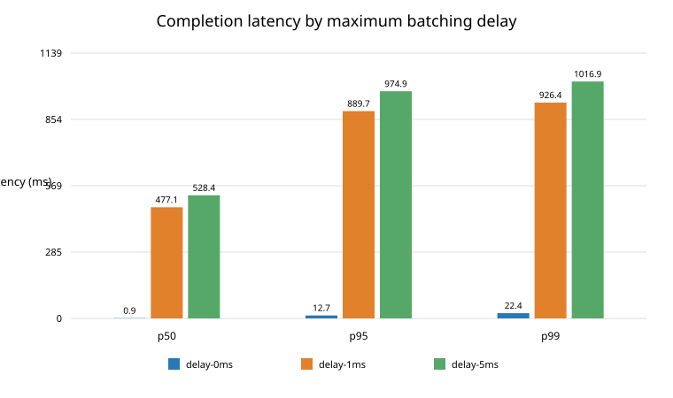
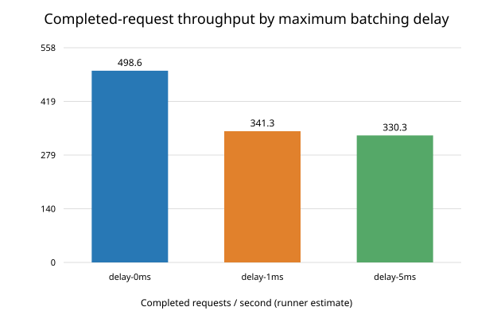

# Phase 10.2: Maximum Batching Delay Experiment

## Objective and configuration

This experiment compares completion latency and achieved throughput at maximum
batching delays of 0 ms, 1 ms, and 5 ms. All configurations used ONNX Runtime
CPU with `tests/data/identity_dynamic_batch_2.onnx`, maximum batch size 8,
fixed-rate open-loop HTTP traffic at 500 requests/second, 1,100 total requests,
and 100 warmup requests followed by 1,000 measured requests. Each configuration
ran three repetitions. Delay was the only intended configuration difference.

The previously available `Batcher` delay parameter was always set to zero by
`ServerRuntime` and was not configurable through the server CLI. The focused
implementation change exposes `--max-batch-delay-ms` and passes it through to
the runtime batcher. The default remains zero milliseconds.

## Methodology and validity

The existing `scripts/run_experiment.py` workflow generated the fixed-rate
traffic, excluded warmup requests from its summary, wrote one request CSV and
metadata sidecar per repetition, and aggregated run-level medians and ranges.
The three InferServe instances ran concurrently on separate local ports; each
used the same model, backend, batch-size limit, and build. The plot script in
this directory renders the three-configuration plots from the runner summary.

All nine measured runs completed successfully. Every CSV has 1,100 request
records, including 100 warmups; all 1,000 measured requests were dispatched and
completed successfully, with no error or undispatched request records. The
runner summary reports 9 successful runs and 0 failed runs.

An initial attempt under the sandbox failed because local HTTP connections were
denied (`Operation not permitted`). Those invalid attempts were replaced by the
successful repetitions after local socket access was approved; the final CSVs
and summary contain only the successful repetitions.

## Results

Values are medians across the three per-run metric values, with the minimum and
maximum run values in parentheses. Percentiles are completion latency from
scheduled arrival, as calculated by the existing plotting/summary helpers.

| Maximum batching delay | p50 latency, ms | p95 latency, ms | p99 latency, ms | Throughput, requests/s |
|---|---:|---:|---:|---:|
| 0 ms | 0.941 (0.835–2.251) | 12.664 (12.371–34.038) | 22.428 (16.249–40.691) | 498.630 (498.197–499.835) |
| 1 ms | 477.096 (438.689–491.080) | 889.684 (765.010–950.366) | 926.394 (801.031–992.848) | 341.300 (332.710–356.341) |
| 5 ms | 528.427 (520.083–599.074) | 974.941 (959.598–1060.639) | 1016.865 (987.510–1102.065) | 330.319 (322.160–333.854) |

## Interpretation

At 0 ms, the server sustained approximately the offered 500 requests/second and
had much lower completion latency. Setting the maximum delay to 1 ms or 5 ms
coincided with markedly higher p50, p95, and p99 latency and throughput below
the offered rate. The 5 ms runs had the highest median latencies and lowest
median throughput. This experiment therefore shows a cost to waiting under
this workload and runtime setup; it does not show a throughput benefit from the
longer delay. The results do not establish a general causal or optimal delay:
there are only three repetitions, run-to-run ranges are nontrivial for tails,
and machine load and runtime scheduling can affect these measurements.

## Limitations and caveats

The CSV and metadata formats do not export the dispatched batch-size
distribution or per-request batch size. Actual batch aggregation was therefore
not measured or confirmed, despite the maximum batch size being set to 8. The
experiment compares configured maximum delay, but cannot attribute the
observed differences to a measured change in formed batch sizes.

Throughput is the existing runner's completed-request estimate over its
measured arrival/completion window, not a server-side throughput counter.
Metadata does not embed the backend/model or CLI settings, so the report and
saved configuration record those settings alongside the sidecars. The plots
show median run-level metrics; the table includes run ranges but not confidence
intervals.

## Artifacts

- `experiment-config.json`: settings and server invocations
- `experiment-summary.json`: run results and aggregates
- `delay-*/run-*/requests.csv` and matching metadata sidecars: raw repetitions
- `latency_percentiles.svg` and `throughput.svg`: comparison plots
- `plot_results.py`: generates the plots from the summary
