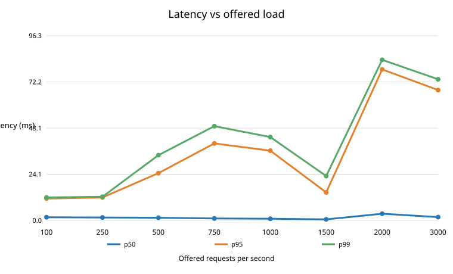
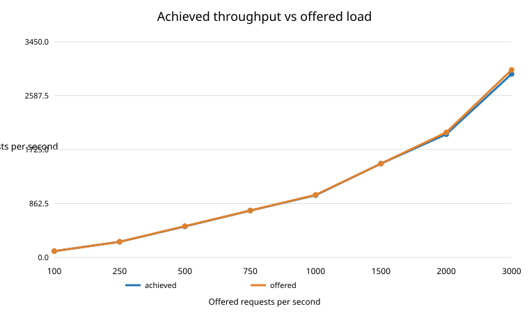
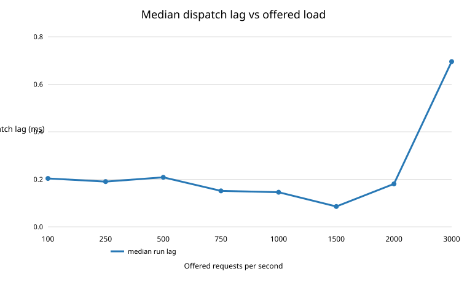

# Phase 10.3: Increasing Offered Load to Saturation

## Objective

Measure how ONNX Runtime CPU behaves as fixed-rate offered load increases,
identifying where latency and dispatch lag rise and achieved throughput stops
tracking the offered rate.

## Workload and configuration

Every configuration used the same ONNX Runtime CPU backend, model
`tests/data/identity_dynamic_batch_2.onnx`, maximum batch size 8, maximum
batching delay 0 ms, HTTP transport, completion polling, 1,100 total requests,
100 warmup requests, and 1,000 measured requests. Each offered rate ran three
repetitions. Only the offered request rate changed.

The initial progression was 100, 250, 500, 750, and 1,000 requests/sec. The
system still tracked offered throughput at 1,000, so 1,500, 2,000, and 3,000
were added as the minimal extension needed to expose the onset of saturation.

## Methodology and validation

The existing `scripts/run_experiment.py` runner generated fixed-rate open-loop
traffic, wrote one CSV and metadata sidecar per repetition, excluded warmup
rows from latency and throughput calculations, and aggregated medians and
ranges of run-level metrics. The final complete matrix contains 8 rates × 3
repetitions = 24 successful runs.

Every final CSV contains 1,100 records, including 100 warmups. Every run has
1,000 measured successful requests, zero error records, and zero undispatched
requests. The final summary reports 24 successful runs and 0 failed runs.

Dispatch lag was calculated directly from each measured CSV as
`actual_send_ms - scheduled_arrival_ms`; run-level medians are reported below.

## Results

Values are medians across the three repetitions; parentheses contain the
minimum and maximum run-level values.

| Offered rate (req/s) | p50 latency (ms) | p95 latency (ms) | p99 latency (ms) | Achieved throughput (req/s) | Median dispatch lag (ms) |
|---:|---:|---:|---:|---:|---:|
| 100 | 1.630 (1.376–1.798) | 11.387 (11.112–11.694) | 11.958 (11.922–12.339) | 100.082 (100.080–100.082) | 0.29 |
| 250 | 1.512 (1.486–1.702) | 11.957 (11.949–12.174) | 12.320 (12.255–12.475) | 249.531 (249.481–250.183) | 0.20 |
| 500 | 1.381 (1.273–2.472) | 24.619 (21.192–26.461) | 33.987 (28.945–38.962) | 495.855 (495.788–500.219) | 0.22 |
| 750 | 1.001 (0.844–2.028) | 40.112 (20.312–40.277) | 49.125 (29.992–56.587) | 748.921 (745.955–750.037) | 0.16 |
| 1,000 | 0.860 (0.782–1.178) | 36.341 (24.618–58.804) | 43.445 (34.101–68.419) | 994.485 (989.587–1,000.164) | 0.15 |
| 1,500 | 0.536 (0.416–0.556) | 14.585 (10.732–23.091) | 23.122 (17.669–30.522) | 1,500.150 (1,480.981–1,500.868) | 0.09 |
| 2,000 | 3.481 (0.384–24.310) | 78.695 (6.210–124.060) | 83.698 (10.852–130.374) | 1,969.904 (1,913.678–2,000.704) | 0.17 |
| 3,000 | 1.700 (0.277–11.587) | 67.951 (4.483–75.361) | 73.551 (10.654–80.594) | 2,934.565 (2,784.073–3,000.768) | 0.70 |

## Interpretation

Achieved throughput tracks the offered rate fairly closely throughout the
100–3,000 requests/sec sweep, including at 2,000 and 3,000 requests/sec. The
results do not establish a clear throughput plateau or a definitive saturation
point. The small shortfalls at the highest rates are accompanied by run-to-run
variation and are insufficient to demonstrate throughput saturation.

Latency tails and dispatch lag show increased variability at higher offered
rates: p95/p99 latency are elevated at several rates, and the 2,000 and 3,000
requests/sec configurations include the clearest high-tail behavior. These
results support a latency degradation/variability warning as load increases,
but should not be described as a demonstrated throughput ceiling. The 3,000
requests/sec median achieved throughput is approximately 2,935 requests/sec,
which remains broadly close to its offered rate.

The p50 values are not monotonic because the workload is short, batching and
scheduling are sensitive to timing, and the three repetitions show substantial
run-to-run variation at higher rates. The p95/p99 and dispatch-lag results are
more informative indicators of latency degradation than p50 alone, but they do
not by themselves establish a throughput saturation point.

## Limitations and caveats

The runner reports completed-request throughput over its measured completion
window, not a server-side throughput counter. Dispatch lag is measured at the
load generator's HTTP send boundary, so it includes client-side scheduling and
transport delay in addition to server queueing.

The existing artifacts do not export formed batch sizes or batch-size
distributions, so actual batch aggregation cannot be directly verified. The
experiment compares offered load with configured batching settings, not measured
batch composition. Only three repetitions and 1,000 measured requests per
rate were used; higher-rate tail metrics have wide run ranges and should not be
treated as precise capacity limits.

## Artifacts

- `experiment-config.json`: final workload and server settings
- `experiment-summary.json`: runner summary and run-level aggregates
- `rate-*/run-*/requests.csv` plus metadata sidecars: raw repetitions
- `latency_vs_offered_load.svg`, `throughput_vs_offered_load.svg`, and `dispatch_lag_vs_offered_load.svg`: plots
- `plot_results.py`: plot generation script
