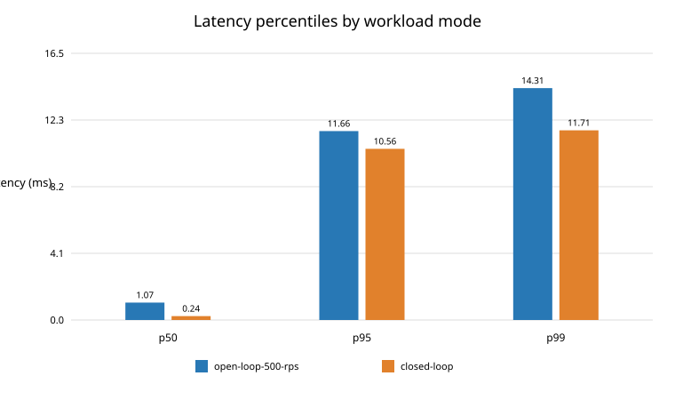
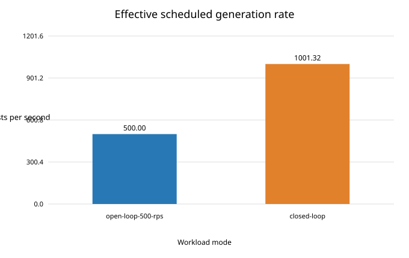

# Phase 10.4: Open-Loop versus Closed-Loop Load Generation

## Objective

Compare independently scheduled open-loop load with the existing closed-loop
load generator and determine whether closed-loop measurements reduce or change
the offered load as request latency increases.

## Methodology and workload difference

Both configurations used ONNX Runtime CPU, the existing
`tests/data/identity_dynamic_batch_2.onnx` fixture, maximum batch size 8,
maximum batching delay 0 ms, HTTP transport, completion polling, 1,100 total
requests, 100 warmup requests, and 1,000 measured requests. Each ran three
repetitions.

The open-loop configuration scheduled requests independently at 500 requests
per second. Its scheduled arrival times remain 2 ms apart even when prior
requests have not completed. The existing closed-loop configuration has no rate
argument and issues one request, waits for its completion-polling result, then
issues the next request. Its request spacing therefore expands when completion
latency expands. No load-generator or server implementation changes were
needed.

## Results

Values are medians across the three repetitions; parentheses contain the
minimum and maximum run-level values.

| Workload mode | p50 latency (ms) | p95 latency (ms) | p99 latency (ms) | Runner throughput (req/s) | Effective scheduled rate (req/s) |
|---|---:|---:|---:|---:|---:|
| Open-loop, 500 RPS | 1.074 (0.874–1.186) | 11.660 (11.542–12.107) | 14.312 (14.261–15.032) | 500.219 (499.945–500.285) | 500 |
| Closed-loop | 0.240 (0.147–0.511) | 10.565 (1.543–11.429) | 11.707 (11.461–11.924) | 1,007.118 (505.966–1,381.828) | 1,001 (518–1,419) |

The effective scheduled rate is calculated from the first and last scheduled
arrival timestamps in each CSV. Closed-loop repetitions varied substantially:
their scheduled spans were 774 ms, 1,098 ms, and 2,124 ms, corresponding to
approximately 1,419, 1,001, and 518 requests/sec. Open-loop spans were fixed at
2,198 ms and 500 requests/sec in all repetitions.

## Interpretation

The closed-loop generator demonstrably changes the offered load: request
spacing is determined by completion, and the effective scheduled rate fell to
about 518 requests/sec in its slowest repetition while the open-loop schedule
remained fixed at 500 requests/sec. The closed-loop mode also had lower median
latency in this run set, but its effective load was not held equal to the
open-loop 500 RPS load.

This comparison is consistent with the mechanism behind coordinated omission:
when a closed-loop request takes longer, the generator waits before issuing the
next request, so it does not continue presenting independent arrivals during
that delay. However, these results do not demonstrate a strong coordinated-
omission effect or quantify one. The open-loop p95/p99 latencies were similar
to the closed-loop values in this run set, and the experiment did not create a
controlled sustained latency episode under identical offered load.

The appropriate conclusion is limited: the existing closed-loop mode is
completion-coupled and can underrepresent latency under a genuinely independent
arrival process when latency increases, but this particular comparison does not
establish the size of that bias.

## Validation and limitations

All six runs completed successfully. Every CSV contains 1,100 records, with 100
warmup records and 1,000 measured successful requests. There were zero error,
undispatched, or failed measured requests.

The runner's throughput summary uses its existing completion-window calculation
and is not a server-side counter. The effective scheduled-rate calculation is
included to show how closed-loop request generation changed over time. The
closed-loop mode is single outstanding request, while the open-loop mode uses
the existing four-worker HTTP dispatch path, so concurrency differs by design.
Only three repetitions were used, and the closed-loop scheduled spans varied
substantially. Actual formed batch sizes are not exported by the existing
artifacts.

## Artifacts

- `experiment-config.json`: exact workload and server settings
- `experiment-summary.json`: runner summary and aggregates
- `open-loop-500-rps/run-*/` and `closed-loop/run-*/`: raw CSVs and metadata sidecars
- `latency_percentiles.svg`, `throughput.svg`, and `effective_generation_rate.svg`: plots
- `plot_results.py`: plot generation script
