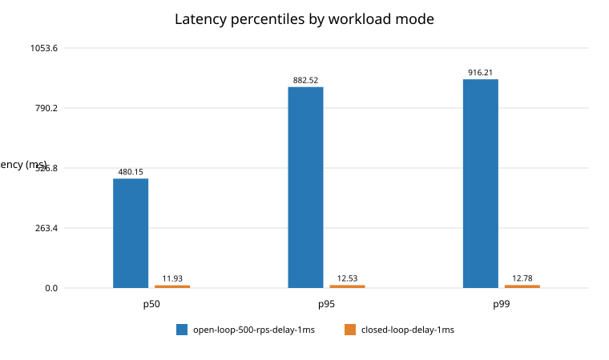
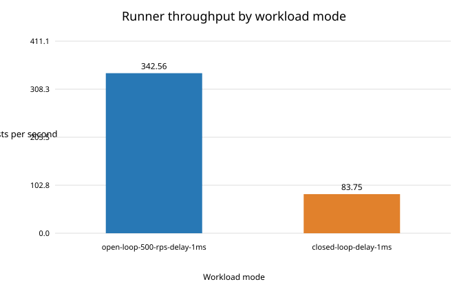
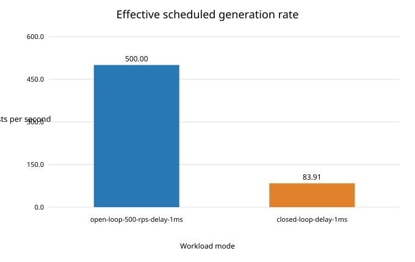

# Phase 10.4 Revised Comparison: Open-Loop versus Closed-Loop at 1 ms Delay

## Rationale and methodology

The original Phase 10.4 zero-delay comparison preserved the scheduling
mechanism difference but did not create a sustained latency episode. Phase 10.2
already established that the existing CLI-supported 1 ms maximum batching delay
caused substantial open-loop queueing at 500 requests/sec. This revised run
uses that supported setting to create a measurable slowdown while keeping all
other server and workload settings identical between modes.

The open-loop configuration independently scheduled 500 requests/sec. The
closed-loop configuration used the existing one-outstanding-request executor:
it waited for each completion-polling result before issuing the next request.
Closed-loop therefore has no fixed offered rate and its effective generation
rate falls when completion latency rises.

Both modes used ONNX Runtime CPU, `tests/data/identity_dynamic_batch_2.onnx`,
maximum batch size 8, maximum batching delay 1 ms, HTTP transport, 1,100 total
requests, 100 warmups, and 1,000 measured requests. Each mode ran three
repetitions. The original zero-delay baseline remains in the parent Phase 10.4
directory and was not replaced.

## Results

Values are medians across repetitions; parentheses contain minimum and maximum
run-level values.

| Workload mode | p50 latency (ms) | p95 latency (ms) | p99 latency (ms) | Runner throughput (req/s) | Effective scheduled rate (req/s) |
|---|---:|---:|---:|---:|---:|
| Open-loop, 500 RPS, 1 ms delay | 480.147 (448.502–502.515) | 882.519 (823.443–914.653) | 916.211 (850.216–953.215) | 342.564 (337.563–350.759) | 500 |
| Closed-loop, 1 ms delay | 11.932 (11.913–12.087) | 12.534 (12.442–12.676) | 12.778 (12.651–12.871) | 83.752 (82.755–83.891) | 84 |

## Interpretation

This revised comparison creates a clear mechanism-level contrast. Open-loop
traffic continues to schedule arrivals every 2 ms despite server slowdown. Its
measured dispatch lag reached roughly 440–490 ms at the median and up to about
849–955 ms per repetition; p50 completion latency was approximately 449–503
ms and achieved throughput fell to roughly 338–351 requests/sec.

Closed-loop traffic waited for each response. Its effective generation rate
fell to approximately 83–84 requests/sec, while p50, p95, and p99 latency
remained near 12 ms and dispatch lag remained near zero. This directly shows
that completion-coupled generation stops presenting independent arrivals during
the open-loop backlog and therefore reports a much smaller latency burden under
this condition.

The result is consistent with coordinated omission: the closed-loop workload
reduces its offered load as latency increases, while open-loop continues to
apply the target schedule. It does not prove that every difference is caused
only by coordinated omission, because the two modes intentionally have
different concurrency and offered-load behavior. The comparison demonstrates
the measurement mechanism and its consequence for this workload, not a general
server capacity law.

## Validation and limitations

All six revised runs completed successfully. Each CSV contains 1,100 records,
including 100 warmups and 1,000 successful measured requests. There were zero
error, undispatched, or failed measured requests.

The runner's throughput is its existing completion-window estimate, not a
server-side counter. The effective scheduled rate is calculated from the first
and last scheduled-arrival timestamps to expose closed-loop load reduction.
Actual formed batch sizes are not exported. The revised condition was selected
from an existing supported CLI setting and prior Phase 10.2 evidence; no server
or load-generator implementation changes were made.

## Artifacts

- `experiment-summary.json`: revised runner summary
- `experiment-config.json`: exact revised settings
- `open-loop-500-rps-delay-1ms/` and `closed-loop-delay-1ms/`: raw CSVs and metadata sidecars
- `latency_percentiles.svg`, `throughput.svg`, `effective_generation_rate.svg`: revised plots
- `plot_results.py`: plot generation script
- Parent `experiment-results/phase-10-4/`: preserved original zero-delay baseline
